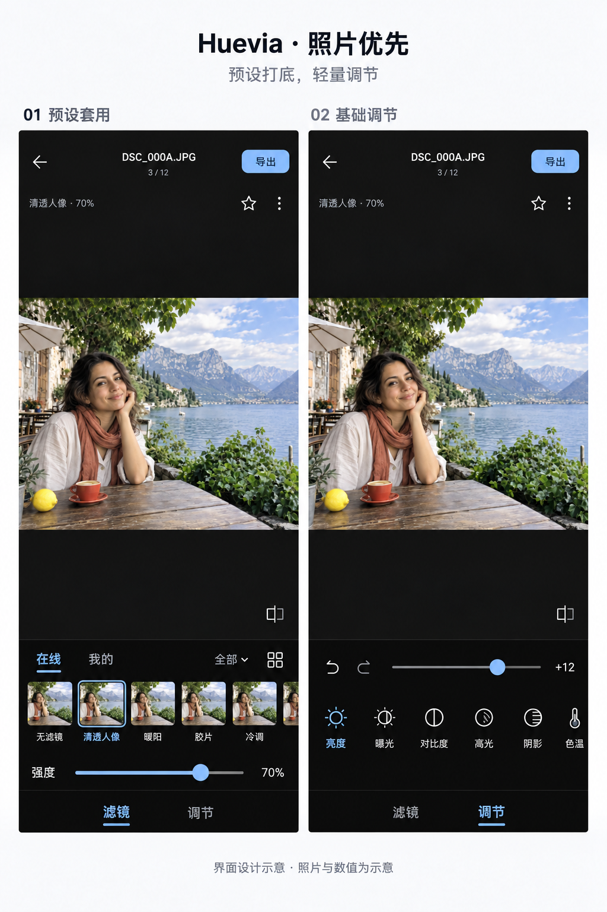

# 预设与基础调整界面设计稿

日期：2026-10-22。当前版本：第二版，用户已批准，已按原生 Android Java / Views 实施（80 / 0.14.0-beta）。用户在第二版后说“开始实现，我睡觉去了”，随后授权测试版发布；发布结果由交付记录单独确认。

两屏为同一编辑页的两个状态：预设套用、基础调节。按用户提供的醒图截图，改为照片画布优先的平面黑色布局。在线／我的与分类合并成一行，缩略图与强度保持紧凑；调节只有一根滑杆和一条参数横栏。预设及强度以小字显示，更换预设保留手动参数，重置调整保留预设。两种模式共享画布边界与照片位置。

本图由内置 image_gen 生成并进行一次布局修订。设计图中的照片效果、滤镜名称、数值与比例为审核示意；实际实现以真实原图比例和原生验证为准。生成图重新构图的照片不进入生产资源，不作为颜色或构图保真证据。13 项参数及行为见 [已确认需求与实施记录](REQUIREMENTS.md)，完整提示词见 [初次生成](design-v2-prompt.txt) 与 [最终修订](design-v2-edit-prompt.txt)，来源见 [design-board-v2.png.json](design-board-v2.png.json)。

布局参考为用户提供的醒图截图，仅借鉴面积分配和轻量工具结构，不使用其中的私人照片、荧光绿色或额外功能。当前编辑页截图 `docs/validation/photo-selection-polish-74/phone/online-selected-stable.png` 仅作为蓝色强调、既有功能和湖畔咖啡样片参考。

[首版设计](design-board.png) 因工具层级过多、照片不突出被用户退回；仅作为审核历史保留，不作为实施依据。

## 实施与证据

当前入口为 `app/src/main/java/cc/huevia/ui/PhotoFilterEditor.java`，画布与照片工具集成位于同目录的 `AlbumPanel.java`。工具区采用贴边实色黑底，224dp 内容加 1dp 分隔；“滤镜／调节”共享同一画布。13 项参数、32 步会话撤销／重做、精确值、按需参数说明及每张照片独立冻结导出已实现，行为见[编辑说明](../../photo-filter-editor.md)。

最终本地 APK 为 80 / `0.14.0-beta`，3,458,669 字节，SHA-256 `4aea78f19ddc4e245e27470b29c9f111674f74c2e22b3229d03a2ec5fd6834bb`。三份最终[原生报告](../../validation/photo-basic-adjustments-80/)分别为 phone、实际字号 1.3、实际横屏，每种 PASS 157（471 条断言记录）；截图包括滤镜、调节、色彩、非法精确值提示、参数说明和导出。`initial/` 的 132 项候选及初轮 `FINISH-REVIEW.md` 保留为历史，不能替代最终包证据；最终完成复核与发布状态另行记录。

[素材清单](ASSET-INVENTORY.md)的结论仍为新增生产栅格 0，结构及参数图标已扩展既有 Canvas `AppIcon`。清单中的代码“需要补齐”和审核状态描述记录其编制时点，本页及已确认需求记录当前实施状态。验证使用既有合成模板照片、真实／手写配方夹具和隔离 Android 模拟器，执行真实 JPEG、EXIF、草稿与 MediaStore 路径；没有实体手机、真实相机、实时生产目录、FPS、TalkBack 或 NX Studio 标定结论。
