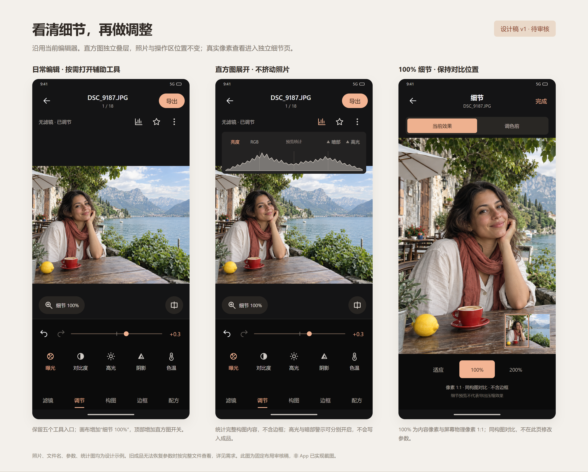
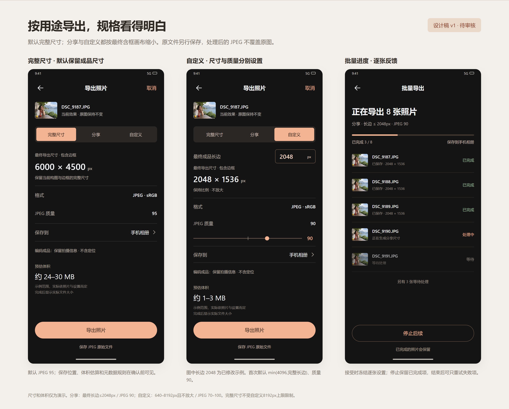

# 图片处理增强 · 审核稿 v1

**已获用户“开始”批准，按本稿进入 91 原生实现。** 这轮准备做 100% 细节查看、直方图与预览警示、三档导出。曲线/HSL、局部修图及 RAW 显影留在后续阶段。

设计沿用现在的黑色编辑区与杏色控件，底部仍是“滤镜 / 调节 / 构图 / 边框 / 配方”。正式审核使用下方两张固定布局渲染图（`review-*-v1.png`）；图像生成的 `design-board-*` 仅为探索参考。设计图中的照片、文件名、数量、尺寸和体积为流程示例，不是 App 运行结果；具体行为以[详细需求](REQUIREMENTS.md)为准。

## 编辑、直方图与细节

从左到右：

1. **日常编辑**：不常驻展开直方图，画面保留完整比例；从照片工具打开直方图，从画布“细节 100%”进入独立细节页。原有五个工具入口与工具区高度保留。
2. **直方图展开**：亮度/RGB 切换，高光与暗部分别开关；统计整张当前构图的效果内容，不统计边框，不因放大局部而改变。它是 sRGB 预览统计，警示叠层不会保存进照片。
3. **细节页**：适应 / 100% / 200%，100% 为一个内容像素对应一个屏幕物理像素；放大后有整图定位小窗。“当前效果 / 调色前”保留相同构图、位置与缩放，都不含边框。页内只查看，回编辑页再调参数。

旧成品无法恢复参数时例外：查看完整已保存 JPEG 的真实像素（含已烘焙边框），不猜测去框，并禁用“调色前”。

## 导出、尺寸与进度

| 档位 | 默认规则 | 使用场景 |
|---|---|---|
| 完整尺寸 | 保留当前构图与边框的完整画布；JPEG 95 | 收藏、交付、进一步处理 |
| 分享 | 最终含框长边最多 2048px；JPEG 90；不放大 | 日常发图 |
| 自定义 | 最终含框长边 640–8192px，且不超过完整画布；JPEG 70–100 | 明确尺寸或质量要求 |

自定义首次长边为 min(4096,完整画布长边)、质量 90；图中的 2048 为已输入的演示值。完整尺寸独立，不受自定义 8192px 上限限制。体积显示“约”或范围，无可靠估算时直接说明，保存后显示实际值。

导出默认手机相册，可改为 App 内；同规格已保存时沿用现有复用／明确另存新副本规则。批量逐张冻结设置，失败可单独重试，停止后保留已完成照片。本轮不新增 App 被关闭后的批量队列恢复承诺。

已确认开始的导出保留当时快照，后续继续调图不重定向该任务；新草稿不会被旧任务误标成已导出。

主导出生成处理后的 JPEG，保留拍摄信息、去掉定位。下方另有“保存 JPEG 原始文件”：只对可信 JPEG 原图显示，经确认忽略全部编辑及导出规格后保存原文件字节；它保留原有信息，可能含定位。两个动作都不覆盖原图，原有 NEF 保存入口保留。

## 请重点审核

- 编辑页新增入口是否容易找到，直方图展开时是否仍让照片成为视觉中心。
- 独立细节页与同构图“调色前”对比是否符合使用习惯。
- 三档导出的默认值、尺寸口径和保存位置是否合适。
- 是否同意本轮先完成这三项，再做曲线/HSL。

本页保留正式设计依据，实施和验收见验证记录。完整的异常、权限、原图保护、版本复用与验收规则见 [REQUIREMENTS.md](REQUIREMENTS.md)；视觉边界见 [BRIEF.md](BRIEF.md)。
