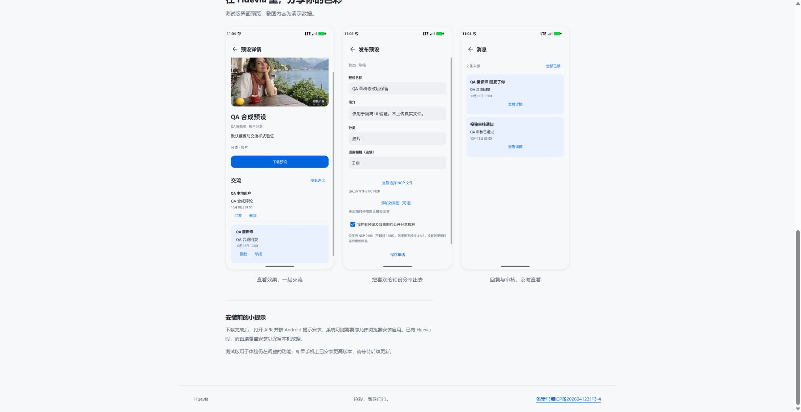

# huevia.cc 域名配置与验收

北京时间 2026-10-21 12:28 完成。正式域名已接入原 CloudBase 上海环境 `nikon-d8girdjsr252fd90e`，网关状态 `SUCCESS`，DNS 与平台 CNAME 状态均为 `OK`，云函数为 `Active`。

## 访问入口

- 后台：[https://huevia.cc/](https://huevia.cc/)，重定向到 `/preset-library/admin/`。
- 测试版下载：[https://huevia.cc/preset-library/download/?channel=beta](https://huevia.cc/preset-library/download/?channel=beta)。当前线上版本为 73 / 0.13.5-beta；本任务未发布本地 74 安装包。
- 目录：[https://huevia.cc/preset-library/catalog.json](https://huevia.cc/preset-library/catalog.json)。

## 云端配置

| 项目 | 实际值 |
| --- | --- |
| DNSPod `@` / CNAME | `huevia.cc.tcbaccess.tencentcloudbase.com`，TTL 600 |
| `_cloudbase-challenge` / TXT | `nikon-d8girdjsr252fd90e`，TTL 600 |
| SSL 证书 | `bjxjYb4F`，免费 90 天，SAN 包含 `huevia.cc` 与 `www.huevia.cc` |
| 证书到期 | 北京时间 2027-01-19 10:59:59，需要重新申请并更新绑定 |
| 网关协议 | `HTTP_TO_HTTPS` |
| 路由 | `/` → `WEB_SCF` / `nikon-preset-library`，路径透传开启 |
| 路由限频 | 环境 100 QPS，每客户端 IP 20 QPS，沿用原入口设置 |
| 云函数附加来源 | `ALLOWED_BROWSER_ORIGINS=https://huevia.cc` |
| `PUBLIC_BASE_URL` | 保留旧 CloudBase Origin，`BASE_PATH=/preset-library` |

证书通过手动添加 `_dnsauth` TXT 验证并签发，未创建自动 DNS 服务角色。该 TXT 为证书校验记录，保留在 DNSPod。此次仅绑定根域名，未为 `www` 添加解析或网关路由，未启用付费加速或证书自动续期。

## 兼容改动

附加浏览器 Origin 只接受精确 HTTPS Origin；原来源保留，不依赖请求 Host 或转发头授权。管理员仍需要有效会话和 CSRF；Cookie 保持 `__Host-`、Secure、HttpOnly、SameSite=Strict 和 host-only。

后台私有预览按经过验证的资产 ID 生成当前站点的鉴权路径，不使用数据库中保存的旧域名私有链接。网页下载严格验证 release UUID、可信 canonical 来源和精确路径，然后生成当前站点的 APK 下载地址。后台“打开下载页”也保持当前站点。

服务端 canonical URL、数据库内容、用户数据与 Android 内置地址未改；已有 Android 包的更新与头像校验继续兼容。云函数配置复核确认仅增加指定来源，其他环境变量和原网关域名、路由均与操作前一致。

## 验证证据

- 完整 Node 测试 138/138 通过；语法/源码检查 58 个模块通过。
- [线上验证](domain-verification.json)：19/19 通过。新旧目录均为 241 款且内容完全一致；新域名管理员登录、权限隔离、CSRF、会话退出及撤销有效。
- 测试版 APK 经新域名完整下载：3,389,037 字节，SHA-256 `f6464b04ed13e749537030e62c087c40dc0a7aae9ee129f2fe703110e1e74f25`，与已发布元数据相符。正式版渠道当前未发布，网页仍可选择测试版。
- [控制面复核](domain-active.json)：网关/DNS/函数就绪，原环境变量及旧路由未改变。
- 浏览器实际打开新域名下载页，渲染 0.13.5-beta 并生成新域名同源安装包链接，截图如下。未在浏览器安装 APK。
- 本任务未上传预设、修改目录、创建普通用户或发布 App。验收所建管理员会话已经退出并确认不可复用。私有样片兼容使用合成 PNG 本地集成测试；生产当前无可用样片，未将其列入线上 19 项。

最终部署包 SHA-256：`93ce97456334b87ba686a9fdbe633fb60c1371523a293f231dbbc6183022e940`，37 个文件，1,305,213 字节。运维脚本、测试与本地凭据不在部署包内。

