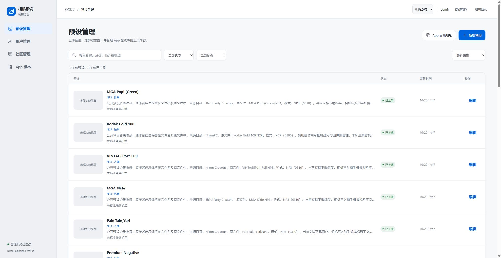
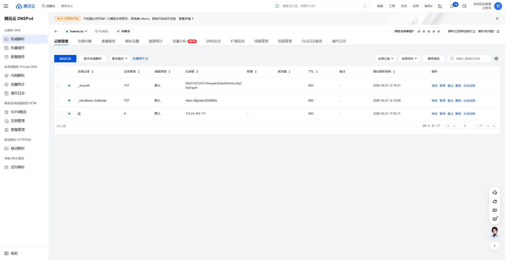
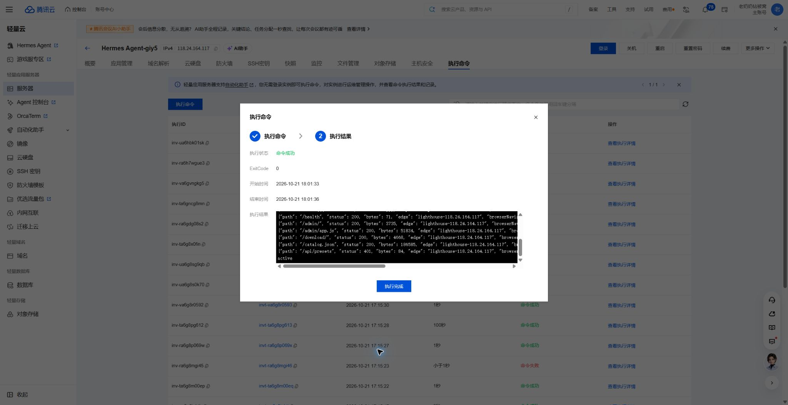

# huevia.cc 轻量服务器代理配置

2026-10-21（北京时间）完成。`huevia.cc` 已从直连 CloudBase 的 CNAME 改为 `A 118.24.164.117`，TTL 600。浏览器通过该轻量服务器访问原 CloudBase 管理后台，域名保持 `huevia.cc`；根路径仍在站内进入 `/preset-library/admin/`。

## 当前配置

| 项目 | 配置 |
| --- | --- |
| 轻量实例 | 成都 `lhins-ohyn9xlu`，Ubuntu 24.04.4 LTS |
| 入口服务 | 现有 Caddy 2.11.4，重载配置后保持 Active |
| DNS | `@ / A / 118.24.164.117`，TTL 600；原验证 TXT 保留 |
| 防火墙 | 新增 TCP 80、443；原 SSH 和 ICMP 规则保留 |
| 代理上游 | `https://huevia.cc.tcbaccess.tencentcloudbase.com` |
| 上游 Host / TLS SNI | `huevia.cc`，验证可信证书链，不关闭 TLS 校验 |
| CloudBase 环境 | `nikon-d8girdjsr252fd90e`，原函数和数据库 |
| 代理识别响应头 | `X-Huevia-Edge: lighthouse-118.24.164.117` |
| 正式配置 | `/etc/caddy/huevia.caddy`，主配置通过 import 引入 |
| 原主配置备份 | `/etc/caddy/Caddyfile.before-huevia-20261021` |

配置源文件：[huevia.caddy](../../../online-library/infra/lighthouse/huevia.caddy)。SHA-256：`866a4fb82ad8ff07535badb9275769c8867290eaf5be2772e38a686e83933464`。

保留原 Caddy 静态站点。先使用仅监听回环地址的临时入口验证代理，再启用正式域名；临时 8081 入口已随正式配置移除。配置验证通过后才重载，未修改管理员密码、登录权限、CloudBase 函数、数据或发布内容。

上游使用独立的 CloudBase 接入域名作连接地址，避免 DNS 切换后代理回连自身；Host 与 TLS SNI 仍使用已绑定的正式域名。浏览器请求保留原 Cookie、Origin 和鉴权信息，地址无需跳到 CloudBase 域名。CloudBase 默认域名的浏览器中间页不能作为正式网站入口，本配置使用正式绑定，符合[平台说明](https://docs.cloudbase.net/service/alias)。

## 验证

- [公网检查](verification.json)：11 项通过。带 `Sec-Fetch-Mode: navigate` 的页面访问正常，无测试域名提示或 HTML 下载；前端脚本和样式正常。
- [公共 DNS 检查](dns.json)：Google Public DNS over HTTPS 返回 `A 118.24.164.117`。本机代理会返回虚拟 DNS 地址，未将本机虚拟地址作为公网解析依据。
- HTTP 返回 308 到 `https://huevia.cc/`；HTTPS 根路径返回 302 到同域后台路径。
- 健康检查指向原环境，公开目录有 241 款；未登录管理 API 返回 401。
- 通过代理下载当前已发布 `cc.huevia` 76 / 0.13.8-beta：3,434,093 字节，SHA-256 `cf74460f3a01ca29250a1c77f8a051bc0cf7e3439df20bb91c9b6b2b33b5fa95`。本次只验证下载，未发布版本。
- Chrome 实际刷新原后台标签页，已有管理员会话继续有效，241 款预设正常显示；没有点击测试域名提示的确认按钮。
- 登录页备案号由 `admin/app.js` 渲染，下载页备案号在 HTML 中，均检查保留 `蜀ICP备2026041231号-4`。

只读检查可重跑：`node online-library/scripts/verify-lighthouse-live.mjs`。它不使用凭据、不创建会话、不改生产数据。

## 证书与运维

浏览器到轻量服务器的证书由 Caddy 自动申请和续期，当前证书到期时间为北京时间 **2027-01-19 16:54:17**，应保持 Caddy 运行以及 80/443 入站可达。

轻量服务器到 CloudBase 的证书仍由原自定义域名绑定提供，证书 ID `bjxjYb4F`，到期时间为北京时间 **2027-01-19 10:59:59**。它与 Caddy 前端证书独立，目前没有为该网关绑定启用自动续期，仍须在到期前更新腾讯云证书和 CloudBase 绑定；Caddy 的前端自动续期不会同步更新网关证书。

轻量套餐当前带宽 2 Mbps，经此服务器的后台和下载请求受该带宽约束。原 Android 内置 CloudBase 地址仍可使用；本次未更改 App 内的相机 Wi-Fi 传输。

回退时先把 DNS 的 `@` 记录恢复为 `CNAME huevia.cc.tcbaccess.tencentcloudbase.com`，等待解析切回并确认访问正常，再恢复主配置备份并执行 `caddy validate --config /etc/caddy/Caddyfile --adapter caddyfile` 和 `systemctl reload caddy`。本次没有删除原 CloudBase 域名绑定，保留回退路径。

